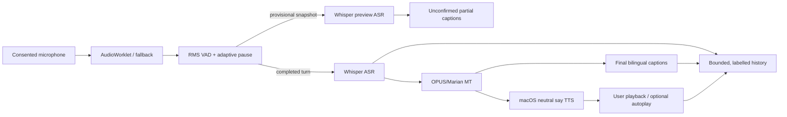

# OpenHear Bridge — M2.1 Verified-Cache & Offline Pilot Operations

**Version 0.5.0 · 8 November 2026 · Patch-compatible with M2-alpha (v0.4.0).**

This incremental release **does not replace the working inference algorithms**. It adds reproducible cache discovery and WAV/voice preflight so the existing verified models can be reused **without broken symbolic links**. Existing 96 tests are retained, with 15 new tests for model discovery and offline experiment readiness.

### Quick start on the Mac (after installing `-e '.[all,test]'` into `.venv`)

```bash
python -m openhear.cli models locate --search-root "$HOME/Downloads"
python -m openhear.cli verify --models-dir auto
bash scripts/mac-launch.sh
```

To validate two real **microphone** recordings, stop the server and run:

```bash
bash scripts/mac-offline-trial.sh "${PWD}/english.wav" "${PWD}/mandarin.wav"
```

**The script requires explicit operator confirmation of disconnection; it does not disable networks or establish OS-wide zero egress.** See [M2.1 Mac acceptance protocol](docs/M2_1_MAC_ACCEPTANCE.md). `--models-dir auto` is accepted by `verify`, `doctor`, `serve`, `translate`, `benchmark run`, and `offline` subcommands. `prepare` deliberately requires a concrete folder and is **not needed** when verified models already exist.

---

# OpenHear Bridge — M1.2 Offline Assurance + M2α Continuous Conversation (previous M2-alpha)

**Previous M2-alpha functionality · Python 3.11+ · macOS Apple Silicon target**

OpenHear Bridge is an **offline-first, nonmedical, Mandarin ↔ English speech-to-speech research prototype**. It extends the user's working M1.1 system with two measurable experimental tracks:

- **M1.2: offline assurance:** an immutable-on-create host-state evidence file, a privacy-conscious bilateral speech trial, and a *Python-level* non-loopback socket guard. True host-wide isolation requires separate macOS/network evidence.
- **M2-alpha: near-live conversation:** continuous microphone capture with an AudioWorklet (legacy fallback), RMS voice-activity detection, adaptive silence-based turn commits, provisional whole-window Whisper previews, automatic final translation after a pause, bounded inference queue, labelled playback, turn history and JSON evidence export.

**Not implemented:** token-level causal simultaneous speech translation, multiple independent participant microphones, robust overlap separation, audiological amplification, privacy-certified production deployment, or research-proven SOTA. The provisional ASR text is **not** a reliable stable-prefix transcript; it may change. Final MT/TTS begins after a turn boundary, not at the start of a sentence.

## Validation boundary

- **96/96 Python regression tests passed** in the build container, using fixture ASR/MT, synthetic WAV data and a FastAPI test client. JavaScript source syntax checked with Node.js.
- The original M1.1 **61** regressions remain included; the macOS `/var` ↔ `/private/var` regression fix is included.
- Previous evidence from the user's Mac: both language directions displayed meaningful Whisper/Marian translations, and Tingting (Mandarin) and Samantha (English) native voice playback succeeded. This is not evidence that the *new continuous mode* has passed on that machine.
- Browser network navigation in the build sandbox was administratively blocked. **No complete real-microphone browser automation or live Apple MPS model benchmark is claimed.**

## Installation without downloading models again

Extract `openhear-bridge-m2-alpha.zip` in `~/Downloads` and use an independent environment so the working M1.1 remains unchanged:

```bash
cd ~/Downloads
unzip -o openhear-bridge-m2-alpha.zip
cd openhear-bridge-m2-alpha
python3 -m venv .venv
source .venv/bin/activate
python -m pip install --upgrade pip
python -m pip install -e '.[all,test]'
python -m unittest discover -s tests -v
```

Reuse the **already verified M1.1 model directory** if it is present:

```bash
ls -ld ../openhear-bridge-m1.1/models
ln -s ../openhear-bridge-m1.1/models models
python -m openhear.cli verify --models-dir models
python -m openhear.cli doctor --models-dir models
```

If the `models` path already exists, do **not** overwrite it. If M1.1 models were stored elsewhere, pass their existing path with `--models-dir` instead of creating a link. Do not run `prepare` unless model weights really are missing.

## M1.1 full microphone-to-translated-speech confirmation

The user has already tested bilingual transcription and native voice synthesis separately. Confirm their combined operation in this release:

```bash
python -m openhear.cli serve --models-dir models --device auto
```

Open **http://127.0.0.1:8765**. Check consent, select English → Mandarin, record and translate a short sentence, and press play on the **translated audio**. Repeat for Mandarin → English. Record whether the browser displayed the voice, audio controls and a generated WAV. **Audio processing times are not acoustic mouth-to-ear delays.**

## M2-alpha: segmented continuous listening

In the same browser page:

1. Select one direction and check recording consent. Press **Start continuous listening**. The normal push-to-talk controls are interlocked against simultaneous use.
2. Speak a sentence, then pause for about 0.5–0.75 seconds. RMS VAD segments the utterance and submits it for local ASR → MT → optional TTS. Speak again to create another labelled turn.
3. For long utterances, tentative **provisional ASR** may appear before the pause. The text is based on repeated complete-window Whisper inference, not a causal streaming model. Only the completed-turn history is treated as final.
4. Review each English/Mandarin text pair and press play. The optional **Auto-play** checkbox is off initially to limit acoustic feedback. The system pauses translated playback if it detects new speech, but this is not a verified echo-cancellation solution.
5. Press **Stop listening**; queued turns can finish after capture stops. Export session JSON only with appropriate consent, or press **Clear live history** to discard the browser's session data.

Implementation bounds: ~11-second maximum utterance segment, at most **2 queued turns** in addition to active inference, visible drop/error counters, and no server-side recording retention after each request. Browser session history retains **20** text/audio turns, while a bounded **500-record metadata-only audit** supports longer reliability studies. In noisy environments a simple RMS gate may falsely detect or miss speech. An AudioWorklet is preferred; `ScriptProcessorNode` is a compatibility fallback.

After exporting a live session, generate descriptive directional latency and reliability statistics:

```bash
python -m openhear.cli live-report \
  --session openhear-live-YOUR-DATE.json \
  --output evidence/live-summary.json
```

The report contains P50/P95/P99 browser pause-to-result and request times, per-direction voice completions, drop counts and an `audit_overflow` completeness flag. It does **not** score semantic adequacy or calibrated acoustic playback latency.

## M1.2: offline verification

The two `offline` subcommands **do not make the Mac air-gapped automatically**. Read [M1.2 offline protocol](docs/M1_2_OFFLINE_ASSURANCE.md).

First create a **host snapshot** with cached model SHA-256 verification:

```bash
mkdir -p evidence
python -m openhear.cli offline snapshot --models-dir models --output evidence/pre-disconnect.json
```

Use the M1.1/M2 push-to-talk page to record and explicitly save two WAV files, for example `english.wav` and `mandarin.wav` (one for each direction). Switch off **all** Internet paths on the Mac (Wi-Fi, Ethernet, tethering, VPN, etc.); loopback still works. Record a second snapshot and a guarded bilingual translation trial:

```bash
python -m openhear.cli offline snapshot --models-dir models --output evidence/disconnected.json
python -m openhear.cli offline trial \
  --models-dir models --device auto \
  --en-audio english.wav --zh-audio mandarin.wav \
  --require-tts --disconnected-confirmed \
  --output evidence/bilateral-disconnected.json
```

`--disconnected-confirmed` is a **user attestation**, not proof derived from the host. The Python guard rejects ordinary Python socket connections and DNS lookups to non-loopback destinations; **it cannot police macOS `say`, native C/C++, browser traffic or kernel networking**. For a separate observed browser trial, you may launch the UI with:

```bash
python -m openhear.cli serve --models-dir models --device auto --python-guard
```

Independent macOS packet/filter monitoring remains necessary before claiming *zero external network access*. The generated local reports contain input and output SHA-256 values, timings, test statuses and denied Python socket attempts; transcripts and audio **are not stored in these offline-trial records by default**. Output report files are create-only (no silent evidence overwrites).

## Research architecture



Offline trial inference shares the model adapters but additionally activates the Python socket guard and writes a verifiable evidence record. The browser performs loopback HTTP calls, even when the WAN is disconnected.

## Evaluation targets (proposed; none achieved by this new release)

| Metric | Initial proposed research gate | Evidence |
|---|---|---|
| Bidirectional speech-to-speech | 20 consented successful utterances per direction | WAV + transcript + translation + generated audio + user review |
| Functional offline | Both directions complete on a demonstrably disconnected host | Pre/post host snapshot, trial JSON; separate network evidence |
| Turn-drop rate | ≤ 2% in a pre-registered 100-turn session | Browser session JSON; all drops retained |
| Pause-to-result latency | P95 ≤ 3 s in quiet bilateral test, if hardware supports | Client `pause_to_result_ms`, P50/P95/P99 computed offline |
| Translation fidelity | Report native-speaker adequacy and critical semantic errors | Human review and frozen reference set; no invented threshold |
| Reliability | ≥ 99% of 200 test turns complete without unrecorded failure | Structured success/timeout/error counts and confidence intervals |

Targets must be re-evaluated based on feasibility and preregistered before confirmatory study. VAD thresholds are demonstration defaults, not calibrated clinical thresholds. See [M2 validation protocol](docs/M2_STREAMING_VALIDATION.md) and [research gates](docs/RESEARCH_GATES.md).

## Project contents

```text
openhear/
  core.py                 Versioned result/evidence orchestration
  adapters.py             Local Whisper, Marian, macOS voice synthesis
  models.py               Locally pinned and hashed model manifest
  web.py                  Loopback FastAPI + whole-window ASR preview API
  stream.py               Adaptive pause thresholds and display prefix helper
  offline.py              Python egress guard + bilateral evidence records
  benchmark.py            Existing 40-slot bilingual study harness
  cli.py                  prepare / verify / speak / serve / offline / benchmark
  static/app.js           M1.1 push-to-talk interface, mode interlock
  static/live.js          Continuous microphone, VAD, queue and history
  static/capture-worklet.js  PCM capture AudioWorklet
  static/index.html, style.css

tests/                    M0/M1/M1.1 regressions + M2 assurance/API tests
docs/                     Research, governance and reproducibility protocols
```

**Scope and licences:** Package application code is MIT-licensed; this licence does not cover third-party model weights, SDKs, voices, pretrained components or recordings. Verify direction-specific model cards before commercial deployment. No medical/hearing-aid or safety-critical use is approved.
